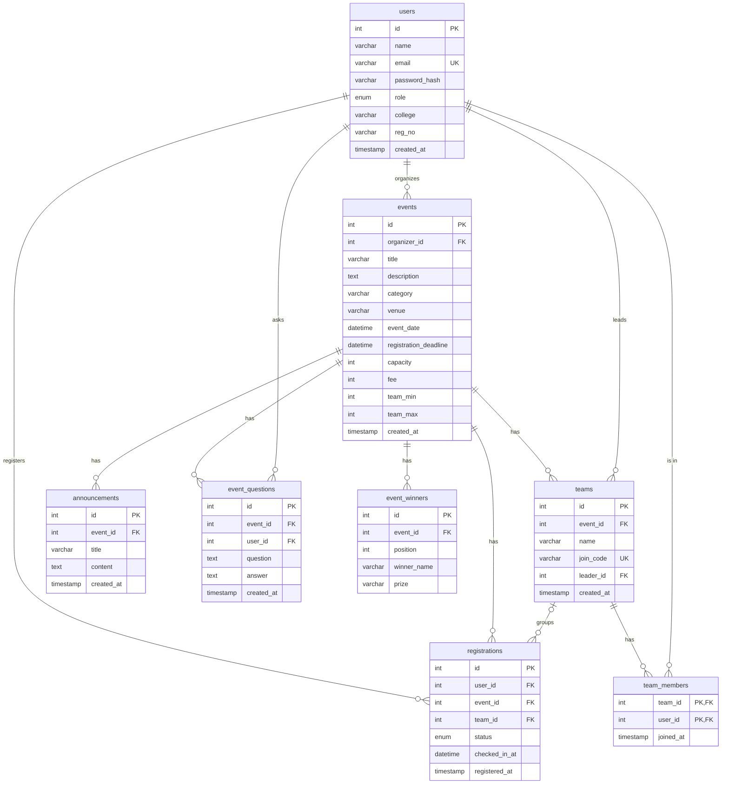

# ShowUp

A campus event discovery and registration platform, built as a second-year
**DBMS project**. Students browse events from different colleges, register
solo or as a team, and get a QR ticket. Organizers create events, see who
registered, post announcements, answer questions, publish winners and check
people in by scanning their QR ticket.

The website is feature-rich, but the database and backend are deliberately
simple: **8 MySQL tables**, **plain SQL** through `mysql2`, and short
**Express** route handlers you can read top to bottom.

```text
React + TypeScript (Vite)  ──HTTP/JSON──►  Node + Express (server/)  ──SQL──►  MySQL 8
       src/                                  mysql2, ? placeholders           sql/schema.sql
```

- All data lives in MySQL. The browser never talks to the database; it calls
  the Express API, which runs the SQL and checks permissions.
- No ORM (no Prisma / Sequelize), no Supabase/Firebase, no email/SMS services,
  no payment gateway.
- Passwords are hashed with bcrypt; logins use a JWT signed with `JWT_SECRET`.

## Features

| Area | What it does | Where the data comes from |
| --- | --- | --- |
| Landing page, event cards | Browse every event with category colours and seats left | `GET /api/events` (JOIN + COUNT) |
| Search & filters | Text search, category, college, price, solo/team, date range, sort | client-side, on the list above |
| Bookmarks | "Save event" | browser `localStorage` only |
| Event detail | Overview, venue map, seats left, deadline countdown | `GET /api/events/:id` |
| Registration | Solo register, cancel, deadline + capacity + duplicate checks | `registrations` table |
| Teams | Create a team, get a 6-character join code, teammates join with the code | `teams`, `team_members` |
| My Events | Your registrations, QR ticket, PNG pass, calendar export, team code | `GET /api/my-registrations` |
| QR check-in | Organizer scans the ticket (or types the number) | `registrations.checked_in_at` |
| Announcements / Q&A / Winners tabs | Organizer posts updates, answers questions, adds results | `announcements`, `event_questions`, `event_winners` |
| Organizer studio | Create / edit / delete events, participant list, CSV export | `events`, `registrations` |
| Calendar export, map & distance, campus map | Google Calendar / .ics, OpenStreetMap embed, VIT campus map | client-side only |
| Certificate image | **Demo feature**: a PNG drawn in the browser, watermarked until you're checked in. Not an official or verifiable certificate. | client-side only |

The event **fee is informational only** — there is no payment processing.

## Running it locally

You need **Node 20+** and **MySQL 8.0.16+**.

```bash
npm install
cp .env.example .env     # set DB_USER / DB_PASSWORD, and a long random JWT_SECRET
npm run db:reset         # LOCAL ONLY: (re)creates the 8 tables and loads sample data
npm run dev              # API on :3001 + website on http://localhost:5173
```

Generate a `JWT_SECRET` with:

```bash
node -e "console.log(require('crypto').randomBytes(32).toString('hex'))"
```

### Demo accounts (from `sql/seed.sql`, password `password123`)

| Email | Role |
| --- | --- |
| `codecell@showup.local` | organizer (Code Cell, VIT Vellore) — owns CodeSprint 24, Figma workshop, Hack Night |
| `culturals@showup.local` | organizer (VIT Chennai) |
| `robotics@showup.local` | organizer (IIT Madras) |
| `ananya@showup.local`, `rohan@showup.local` | students in team **NeuralCraft** (join code `NC8821`) |
| `priya@showup.local`, `vikram@showup.local`, `sameer@showup.local` | students |

A good demo: sign in as `sameer@showup.local`, open **CodeSprint 24**, choose
**Join with code** → `NC8821`. Then sign in as `codecell@showup.local` →
Organizer Studio → **Check-in** and type Sameer's ticket number from his My
Events page.

### Database scripts

| Command | What it runs | Safe on real data? |
| --- | --- | --- |
| `npm run db:init` | `sql/schema.sql` — `CREATE TABLE IF NOT EXISTS` for all 8 tables | Yes, never deletes anything |
| `npm run db:seed` | `sql/seed.sql` — sample users, events, teams… (fresh DB only) | Adds rows only |
| `npm run db:reset` | `sql/reset.sql` → `schema.sql` → `seed.sql` | **No — local development only** |

The same files work with the MySQL client or MySQL Workbench:
`mysql -u root -p < sql/schema.sql`, then `mysql -u root -p showup < sql/seed.sql`.

### Moving a local database from the old schema

Earlier versions of ShowUp used a different, larger schema (`profiles`,
`sessions`, `password_resets`, `teammate_listings`, text ids). It is **not**
upgraded in place. For your **local development database only**:

1. Make sure `.env` points at your local server (`DB_HOST=127.0.0.1` or
   `localhost`) and the right `DB_NAME`.
2. Optional backup: `mysqldump -u root -p showup > showup_old_backup.sql`
3. Run `npm run db:reset`. It drops the old *and* new ShowUp tables, creates
   the 8 new tables and loads the sample data.

`server/run-sql.js` refuses to run `reset.sql` unless `DB_HOST` is localhost
and `NODE_ENV` is not `production`. Never run `sql/reset.sql` against a shared
or production database.

### Production build

```bash
npm run build                    # builds the React app into dist/
NODE_ENV=production npm start    # one process serves dist/ and /api on PORT
```

## Database design

### The 8 tables

```sql
users          (id PK, name, email UNIQUE, password_hash, role ENUM('student','organizer'),
                college, reg_no, created_at)
events         (id PK, organizer_id FK→users, title, description, category, venue,
                event_date, registration_deadline, capacity, fee, team_min, team_max, created_at)
teams          (id PK, event_id FK→events, name, join_code UNIQUE, leader_id FK→users, created_at,
                UNIQUE(event_id, name))
team_members   (team_id FK→teams, user_id FK→users, joined_at, PRIMARY KEY(team_id, user_id))
registrations  (id PK, user_id FK→users, event_id FK→events, team_id FK→teams NULL,
                status ENUM('confirmed','cancelled'), checked_in_at, registered_at,
                UNIQUE(user_id, event_id))
announcements  (id PK, event_id FK→events, title, content, created_at)
event_questions(id PK, event_id FK→events, user_id FK→users, question, answer NULL, created_at)
event_winners  (id PK, event_id FK→events, position, winner_name, prize NULL)
```

The full definitions, with `NOT NULL`, `CHECK` constraints and comments, are in
[`sql/schema.sql`](sql/schema.sql).

### ER diagram



### Every foreign key

| Foreign key | Points to | Meaning | On delete |
| --- | --- | --- | --- |
| `events.organizer_id` | `users.id` | the organizer who created the event (1 user → many events) | CASCADE: deleting an organizer deletes their events |
| `teams.event_id` | `events.id` | the event the team is competing in (1 event → many teams) | CASCADE |
| `teams.leader_id` | `users.id` | the student who created the team | CASCADE |
| `team_members.team_id` | `teams.id` | half of the many-to-many link users ↔ teams | CASCADE: deleting a team removes its memberships |
| `team_members.user_id` | `users.id` | the other half of that link | CASCADE |
| `registrations.user_id` | `users.id` | who registered (many-to-many users ↔ events) | CASCADE |
| `registrations.event_id` | `events.id` | which event | CASCADE: deleting an event deletes its registrations |
| `registrations.team_id` | `teams.id` | the team, or `NULL` for solo | SET NULL: if a team row disappears the registration stays |
| `announcements.event_id` | `events.id` | the event it belongs to | CASCADE |
| `event_questions.event_id` | `events.id` | the event being asked about | CASCADE |
| `event_questions.user_id` | `users.id` | the student who asked | CASCADE |
| `event_winners.event_id` | `events.id` | the event the result is for | CASCADE |

So `DELETE FROM events WHERE id = ?` removes the event's teams, team members,
registrations, announcements, questions and winners in one statement.

### DBMS concepts and where to find them

| Concept | Example in this project |
| --- | --- |
| Primary keys | `INT AUTO_INCREMENT PRIMARY KEY` on 7 tables; composite `PRIMARY KEY(team_id, user_id)` on `team_members` |
| Foreign keys | 12 of them — table above |
| One-to-many | users → events, events → teams / announcements / questions / winners |
| Many-to-many | users ↔ teams through `team_members`; users ↔ events through `registrations` |
| CRUD | events: `INSERT` (POST), `SELECT` (GET), `UPDATE` (PUT), `DELETE` (DELETE) in `server/routes/events.js` |
| INNER JOIN | events ⋈ users for the organizer's name; questions ⋈ users for the asker's name |
| LEFT JOIN | events ⟕ registrations (events with 0 registrations still appear); registrations ⟕ teams (solo rows have no team) |
| COUNT / GROUP BY | `COUNT(r.id) … GROUP BY e.id` for seats taken on every event |
| UNIQUE / NOT NULL | `users.email`, `teams.join_code`, `UNIQUE(user_id, event_id)`, `UNIQUE(event_id, name)`; `NOT NULL` on required columns |
| CHECK | `capacity > 0`, `fee >= 0`, `team_max >= team_min`, `position >= 1` |
| Transactions + row locks | registering, creating/joining a team, cancelling — `START TRANSACTION … SELECT … FOR UPDATE … COMMIT` |

### Example queries

Seats taken on every event (INNER JOIN, LEFT JOIN, COUNT, GROUP BY) —
this is the query behind `GET /api/events`:

```sql
SELECT e.id, e.title, u.name AS organizer, e.capacity,
       COUNT(r.id) AS registered
  FROM events e
  JOIN users u ON u.id = e.organizer_id
  LEFT JOIN registrations r ON r.event_id = e.id AND r.status = 'confirmed'
 GROUP BY e.id
 ORDER BY e.event_date;
```

A team and its members (many-to-many through `team_members`):

```sql
SELECT t.name AS team, t.join_code, u.name AS member, (u.id = t.leader_id) AS is_leader
  FROM teams t
  JOIN team_members tm ON tm.team_id = t.id
  JOIN users u ON u.id = tm.user_id
 WHERE t.join_code = 'NC8821';
```

Attendance per event (aggregate on a nullable column):

```sql
SELECT e.title,
       COUNT(*)               AS confirmed,
       COUNT(r.checked_in_at) AS checked_in
  FROM registrations r
  JOIN events e ON e.id = r.event_id
 WHERE r.status = 'confirmed'
 GROUP BY e.id, e.title;
```

Teams that still need members (GROUP BY + HAVING):

```sql
SELECT e.title, t.name, COUNT(tm.user_id) AS members, e.team_min
  FROM teams t
  JOIN events e ON e.id = t.event_id
  JOIN team_members tm ON tm.team_id = t.id
 GROUP BY t.id, e.title, t.name, e.team_min
HAVING COUNT(tm.user_id) < e.team_min;
```

Unanswered questions for one organizer's events:

```sql
SELECT e.title, u.name AS asked_by, q.question
  FROM event_questions q
  JOIN events e ON e.id = q.event_id
  JOIN users u  ON u.id = q.user_id
 WHERE e.organizer_id = 1 AND q.answer IS NULL;
```

## What happens in the database

### Solo registration — `POST /api/events/:id/register`

All in one transaction (`transaction()` in `server/db.js`):

1. `SELECT * FROM events WHERE id = ? FOR UPDATE` — lock the event row. A
   second person registering for the same event now waits here until this
   transaction finishes, so two people can't both take the last seat.
2. Reject if `registration_deadline` has passed, or if it's a team event.
3. `SELECT id, status FROM registrations WHERE user_id = ? AND event_id = ?` —
   reject if already `confirmed` (the `UNIQUE(user_id, event_id)` constraint
   is the database-level backstop).
4. `SELECT COUNT(*) FROM registrations WHERE event_id = ? AND status = 'confirmed'`
   — reject if it is `>= capacity`.
5. `INSERT INTO registrations (user_id, event_id, team_id, status) VALUES (?, ?, NULL, 'confirmed')`,
   or, if the person had cancelled before, `UPDATE` that same row back to
   `confirmed` (so their ticket number stays the same).
6. `COMMIT`. The new `registrations.id` is the number inside the QR ticket
   (`SHOWUP-REG-<id>`).

**Cancelling** (`DELETE /api/registrations/:id`) sets `status = 'cancelled'`
(the row is kept as history), which frees the seat because seats are counted
from `confirmed` rows.

**Check-in** (`POST /api/registrations/:id/check-in`) is allowed only for the
event's organizer, and only for a `confirmed` registration that isn't checked
in yet: `UPDATE registrations SET checked_in_at = CURRENT_TIMESTAMP WHERE id = ?
AND status = 'confirmed' AND checked_in_at IS NULL`.

### Team registration

**Creating a team** — `POST /api/events/:id/teams { name }`, one transaction:

1. Lock the event row (`FOR UPDATE`); check the deadline and that `team_max > 1`.
2. Check the student isn't already registered, and that a seat is free.
3. `INSERT INTO teams (event_id, name, join_code, leader_id)` with a random
   6-character code (`join_code` is `UNIQUE`; `UNIQUE(event_id, name)` stops
   duplicate team names in one event).
4. `INSERT INTO team_members (team_id, user_id)` for the leader.
5. `INSERT INTO registrations (…, team_id, 'confirmed')` for the leader.

**Joining** — `POST /api/teams/join { join_code }`, one transaction:

1. `SELECT * FROM teams WHERE join_code = ?`, then lock that team's event row.
2. Check the deadline, that the student isn't already registered for the event,
   that `COUNT(*)` of `team_members` is below `team_max`, and that a seat is free.
3. `INSERT INTO team_members` and `INSERT INTO registrations` for the new member.

Every team member therefore has **their own registration row and their own QR
ticket**, and capacity simply counts people. Each teammate signs up for their
own account — no placeholder accounts are created. `team_max` is enforced when
joining; a team below `team_min` is shown as "needs N more" to the team and
the organizer.

**A member cancelling** removes their `team_members` row. If the team is now
empty it is deleted; if the leader left, the earliest remaining member becomes
leader (`UPDATE teams SET leader_id = (SELECT user_id FROM team_members … LIMIT 1)`).

## API endpoints

🔒 = needs `Authorization: Bearer <token>`. 🎓 = students only. 🛠 = organizers only.

| Method & path | Who | SQL it runs |
| --- | --- | --- |
| `POST /api/auth/signup` | anyone | `INSERT INTO users` (bcrypt hash) |
| `POST /api/auth/login` | anyone | `SELECT … FROM users WHERE email = ?` + bcrypt compare |
| `GET /api/auth/me` | 🔒 | `SELECT … FROM users WHERE id = ?` |
| `GET /api/events` | anyone | events ⋈ users ⟕ registrations, `COUNT … GROUP BY` |
| `GET /api/events/:id` | anyone | same, for one event |
| `POST /api/events` | 🔒🛠 | `INSERT INTO events` |
| `PUT /api/events/:id` | 🔒🛠 owner | `UPDATE events … WHERE id = ?` |
| `DELETE /api/events/:id` | 🔒🛠 owner | `DELETE FROM events` (cascades) |
| `POST /api/events/:id/register` | 🔒🎓 | transaction: lock, count, `INSERT INTO registrations` |
| `GET /api/my-registrations` | 🔒 | registrations ⋈ events ⋈ users ⟕ teams |
| `DELETE /api/registrations/:id` | 🔒 participant or organizer | transaction: `UPDATE … status = 'cancelled'`, team clean-up |
| `GET /api/events/:id/registrations` | 🔒🛠 owner | registrations ⋈ users ⟕ teams |
| `POST /api/registrations/:id/check-in` | 🔒🛠 owner | `UPDATE registrations SET checked_in_at = …` |
| `POST /api/events/:id/teams` | 🔒🎓 | transaction: `INSERT` teams, team_members, registrations |
| `POST /api/teams/join` | 🔒🎓 | transaction: `INSERT` team_members, registrations |
| `GET /api/teams/:id` | 🔒 member or organizer | team_members ⋈ users |
| `GET /api/events/:id/announcements` | anyone | `SELECT … ORDER BY created_at DESC` |
| `POST /api/events/:id/announcements` | 🔒 event owner | `INSERT INTO announcements` |
| `GET /api/events/:id/questions` | anyone | event_questions ⋈ users |
| `POST /api/events/:id/questions` | 🔒 | `INSERT INTO event_questions` |
| `PUT /api/questions/:id/answer` | 🔒 event owner | `UPDATE event_questions SET answer = ?` |
| `GET /api/events/:id/winners` | anyone | `SELECT … ORDER BY position` |
| `POST /api/events/:id/winners` | 🔒 event owner | `INSERT INTO event_winners` |

Logging out happens in the browser: the token is deleted from
`localStorage`. Tokens expire after 7 days.

## What was removed in the simplification

- **Tables:** `profiles` (replaced by the smaller `users`), `sessions`,
  `password_resets`, `teammate_listings`. Ids changed from text/UUIDs to
  `INT AUTO_INCREMENT`.
- **Columns:** user state/city/branch/year/phone/bio/GitHub/LinkedIn; event
  club id/name, tagline, rules (now part of the description), scope,
  state/city/college (the host college now comes from the organizer via a
  JOIN), end time, banner colour, draft status; team project idea;
  announcement urgency and author name; question author name / answered-by /
  answered-at; winner title, college, project title/link, announced-by.
- **Auth extras:** server-side sessions table, forgot/reset password,
  rate limiting, onboarding step, placeholder accounts for teammates.
- **Messaging:** Resend email, Twilio / Fast2SMS / 2Factor SMS, WhatsApp,
  registration notifications and their UI messages and `.env` settings.
- **Teammate finder:** the "Find Teammates" tab, listings, skill matching and
  WhatsApp contact (team creation and joining are kept).
- **Registration extras:** waitlist and waitlist promotion, adding teammates
  by email, removing team members, team project pitches.
- **Payments:** the simulated UPI checkout modal. The fee is shown only.
- **Other:** the graVITas '26 fest hub and the Unstop/graVITas sync scripts
  (external scraping), the public "verified portfolio" page, the OD
  attendance-letter generator, the organizer "sample event" generator (use
  `sql/seed.sql` instead), and "verified / immutable / cryptographic" wording
  on certificates.

## Project structure

```text
sql/
  schema.sql        # the 8 tables (safe to re-run)
  seed.sql          # sample data
  reset.sql         # LOCAL ONLY: drops all ShowUp tables
server/
  index.js          # Express app, mounts the routes, error handler
  db.js             # MySQL pool + transaction() helper
  auth.js           # bcrypt, JWT, requireAuth / requireOrganizer / requireStudent
  helpers.js        # HttpError and input validation
  run-sql.js        # runs the files in sql/ (npm run db:*)
  routes/
    auth.js         # signup, login, me
    events.js       # event CRUD
    registrations.js# register, my registrations, cancel, participants, check-in
    teams.js        # create team, join with code, team details
    community.js    # announcements, questions, winners
src/
  lib/api.ts        # every API call the React app makes
  types/index.ts    # TypeScript shapes of the API's JSON
  context/          # signed-in user (AuthContext)
  components/       # EventCard, tabs, QR ticket, team & certificate modals, ...
  pages/            # landing, events, event detail, My Events, profile, campus map
  pages/organizer/  # studio, create/edit event, participants, QR check-in
```
