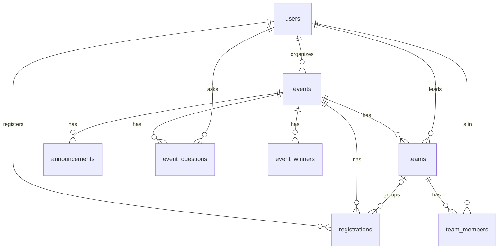

# ShowUp — Project Submission Document (DBMS Project)

**Student Name:** Rayna Agarwal  
**Registration Number:** 25BCE0703  
**Institution:** Vellore Institute of Technology (VIT), Vellore  
**Department:** Computer Science & Engineering (CSE)  
**GitHub Repository:** [https://github.com/raynaagarwal01-rgb/ShowUp](https://github.com/raynaagarwal01-rgb/ShowUp)  
**Google Drive Submission Folder:** [https://drive.google.com/drive/folders/1NqCytuNS5DiaBu40F68yNv-zc6RESz7v](https://drive.google.com/drive/folders/1NqCytuNS5DiaBu40F68yNv-zc6RESz7v)  
**Hosted frontend (Vercel):** [https://showup-campus.vercel.app](https://showup-campus.vercel.app) — static hosting only; the Express + MySQL backend runs locally (see Section 8)  
**Submission Date:** October 2026  

---

## 1. Executive Summary & Problem Solved

At universities like **VIT Vellore**, students take part in hackathons, workshops, competitions and cultural events, but registration is scattered across Google Forms, WhatsApp groups and external links. Students miss deadlines, lose team codes and miss organizer updates; organizers keep attendance on paper.

**ShowUp** is one website for the whole event lifecycle: students browse events from different colleges, register solo or as a team, and get a QR ticket; organizers create events, see participants, post announcements, answer questions, publish winners and check people in by scanning tickets.

It is built as a **DBMS project**: every piece of data lives in a **MySQL 8 database of 8 tables**, accessed through **plain SQL** (no ORM) from a small **Node.js + Express** API. The React website looks feature-rich, but the database and backend are deliberately simple enough to explain table by table and query by query.

**Key features**

1. **Event directory** — search, category / college / price / solo-team / date filters, sorting and locally saved bookmarks.
2. **Event detail page** — overview, venue map and distance, live seats left, deadline countdown, calendar export.
3. **Solo registration** — with server-side checks for deadline, capacity and duplicates.
4. **Team registration** — create a team, receive a 6-character join code, teammates sign up and join with the code.
5. **QR tickets** — every registration gets a ticket (`SHOWUP-REG-<id>`), viewable in My Events and downloadable as a PNG pass.
6. **QR check-in** — organizers scan tickets with a camera (or type the number); attendance is stored in the database.
7. **Announcements, Q&A and Winners tabs** — organizer updates, student questions with organizer answers, and a results podium.
8. **Organizer studio** — create, edit and delete events, participant list grouped by team, CSV export.
9. **Participation certificate (demo)** — a PNG drawn in the browser, watermarked until the student is checked in. It is a demo feature, not an official or verifiable certificate.

The event fee is **informational only** — there is no payment processing.

---

## 2. Page-by-Page Guide

### Page 1: Landing Page (`/`)
- **Logo** — returns to the home page from anywhere.
- **"Browse events"** — opens the event directory (`/events`); signed-out visitors are sent to log in first and brought back afterwards.
- **"Host an event"** — opens sign-up so a club can create an organizer account.
- **Feature tiles** — register once, solo or team, QR check-in, one dashboard.
- **Navbar** — `Events`, `Organizer Studio` (organizers), `My Events` (students), `Profile`, `Sign in` / `Get started` / `Sign out`.

### Page 2: Sign Up & Log In (`/signup`, `/login`)
- Sign up as a **Student** or **Club organizer** with name, email, password, and optionally college and registration number.
- Passwords are stored only as **bcrypt hashes**; logging in returns a **JWT** that the browser sends with each request.
- **Sign out** deletes the token from the browser.

### Page 3: Event Directory (`/events`)
- **Search bar** — matches event title, organizer, college and description.
- **College dropdown** — colleges come from each event's organizer (a JOIN with `users`).
- **Category pills** — Hackathon, Workshop, Competition, Cultural, Talk; plus **Saved** (bookmarks stored in the browser).
- **Price** (any / free / paid), **Solo or team**, **date range** and **sort** (soonest, latest, deadline).
- **Event cards** — category, seats left (from a `COUNT` in SQL), venue with **Map & Distance**, team size, date, deadline, fee and a bookmark button.

### Page 4: Event Details & Registration (`/events/:id`)
- **Info tiles** — college, venue (with **Map & How Far**), date and time, participation (solo or team size).
- **Tabs**
    1. **Overview** — the event description and rules.
    2. **Announcements** — notices posted by the event's organizer.
    3. **Q&A** — signed-in students ask questions; only the event's organizer can answer.
    4. **Winners & Results** — 1st/2nd/3rd podium and special mentions entered by the organizer.
- **Registration panel**
    - Solo events: **Register**.
    - Team events: **Create team** (enter a team name → get a join code) or **Join with code**.
    - Success is shown directly on the page — no email or SMS.
    - Once registered: status badge, team join code with **Copy**, **Download Pass (PNG)**, **Certificate (demo)**, **My Team**, **View my ticket**.
    - **Add to calendar** — Google Calendar link or `.ics` download.

### Page 5: My Events (`/dashboard`)
- Every event the student is registered for, with team name and join code.
- **Show ticket** — the QR code for check-in; **Download Pass (PNG)**.
- **My Team** — members, leader, open slots, join code and a copyable invite message.
- **Certificate**, **Add to calendar**, **Map & Distance**.
- **Cancel (X)** — cancels the registration (with confirmation) and frees the seat.

### Page 6: Profile (`/profile`)
- Account details from the `users` table (name, email, role, college, registration number, member since).
- Summary counts — registered events, events attended (checked in), teams; for organizers, events hosted and total participants.

### Page 7: Organizer Studio (`/organizer`)
- All events created by the organizer with confirmed participants vs capacity.
- Buttons per event: **Registrants & Teams**, **Check-in**, **Edit**, **Delete** (with confirmation).
- **New event** — form with title, description, category, venue, date and time, registration deadline, capacity, fee, minimum and maximum team size.

### Page 8: Participants (`/organizer/events/:id`)
- KPI cards — confirmed participants, spots left, teams formed, checked in.
- **By team** view — each team with its join code, members, leader badge, check-in status and a "needs N more" warning for teams below the minimum size.
- **All participants** table — ticket number, name, email, college and registration number, team, status, check-in.
- **Search** and **Export participants (CSV)**.

### Page 9: QR Check-in (`/organizer/events/:id/checkin`)
- Camera scanner (`html5-qrcode`) reads the ticket QR code.
- Manual entry — type `42` or `SHOWUP-REG-42`.
- The server only accepts tickets for **this organizer's event** that are **confirmed** and **not already checked in**; the participant's name is shown on success.

### Page 10: Campus Map (`/campus-map`)
- A clickable map of VIT Vellore buildings with floor directories and the events held at each venue (runs in the browser).

---

## 3. Database Design

### 3.1 The 8 tables

| # | Table | Columns | Keys & constraints |
| :--- | :--- | :--- | :--- |
| 1 | `users` | id, name, email, password_hash, role, college, reg_no, created_at | PK id; email UNIQUE NOT NULL; role ENUM('student','organizer') |
| 2 | `events` | id, organizer_id, title, description, category, venue, event_date, registration_deadline, capacity, fee, team_min, team_max, created_at | PK id; FK organizer_id → users; CHECK capacity > 0, fee ≥ 0, team_max ≥ team_min ≥ 1 |
| 3 | `teams` | id, event_id, name, join_code, leader_id, created_at | PK id; FK event_id → events; FK leader_id → users; join_code UNIQUE; UNIQUE(event_id, name) |
| 4 | `team_members` | team_id, user_id, joined_at | composite PK (team_id, user_id); FKs → teams, users |
| 5 | `registrations` | id, user_id, event_id, team_id, status, checked_in_at, registered_at | PK id; FKs → users, events, teams (team_id may be NULL); UNIQUE(user_id, event_id); status ENUM('confirmed','cancelled') |
| 6 | `announcements` | id, event_id, title, content, created_at | PK id; FK event_id → events |
| 7 | `event_questions` | id, event_id, user_id, question, answer, created_at | PK id; FKs → events, users; answer NULL until answered |
| 8 | `event_winners` | id, event_id, position, winner_name, prize | PK id; FK event_id → events; CHECK position ≥ 1 |

The full `CREATE TABLE` statements are in `sql/schema.sql`.

### 3.2 ER diagram



### 3.3 Foreign keys

| Foreign key | References | Meaning | On delete |
| :--- | :--- | :--- | :--- |
| `events.organizer_id` | `users.id` | organizer who created the event (one user → many events) | CASCADE |
| `teams.event_id` | `events.id` | event the team competes in (one event → many teams) | CASCADE |
| `teams.leader_id` | `users.id` | student who created the team | CASCADE |
| `team_members.team_id` | `teams.id` | many-to-many link users ↔ teams | CASCADE |
| `team_members.user_id` | `users.id` | many-to-many link users ↔ teams | CASCADE |
| `registrations.user_id` | `users.id` | who registered (many-to-many users ↔ events) | CASCADE |
| `registrations.event_id` | `events.id` | which event | CASCADE |
| `registrations.team_id` | `teams.id` | the team, NULL for solo | SET NULL |
| `announcements.event_id` | `events.id` | event the notice belongs to | CASCADE |
| `event_questions.event_id` | `events.id` | event being asked about | CASCADE |
| `event_questions.user_id` | `users.id` | student who asked | CASCADE |
| `event_winners.event_id` | `events.id` | event the result is for | CASCADE |

Because of the cascades, `DELETE FROM events WHERE id = ?` removes the event's teams, team members, registrations, announcements, questions and winners in one statement.

### 3.4 DBMS concepts demonstrated

| Concept | Where |
| :--- | :--- |
| Primary keys | `INT AUTO_INCREMENT PRIMARY KEY` on 7 tables; composite `PRIMARY KEY(team_id, user_id)` |
| Foreign keys | 12 foreign keys (table above) |
| One-to-many | users → events; events → teams, announcements, questions, winners |
| Many-to-many | users ↔ teams via `team_members`; users ↔ events via `registrations` |
| CRUD | events: INSERT, SELECT, UPDATE, DELETE |
| INNER JOIN | events ⋈ users (organizer name); event_questions ⋈ users (asker name) |
| LEFT JOIN | events ⟕ registrations (events with no registrations still listed); registrations ⟕ teams (solo rows) |
| COUNT / GROUP BY | seats taken per event; check-ins per event; team sizes |
| UNIQUE / NOT NULL / CHECK | email, join_code, (user_id, event_id), (event_id, name); capacity, fee, team size, position |
| Transactions & row locks | register, create team, join team, cancel: `START TRANSACTION … SELECT … FOR UPDATE … COMMIT` |

### 3.5 Example SQL queries

Seats taken per event (INNER JOIN + LEFT JOIN + COUNT + GROUP BY) — the query behind the event list:

```sql
SELECT e.id, e.title, u.name AS organizer, e.capacity,
       COUNT(r.id) AS registered
  FROM events e
  JOIN users u ON u.id = e.organizer_id
  LEFT JOIN registrations r ON r.event_id = e.id AND r.status = 'confirmed'
 GROUP BY e.id
 ORDER BY e.event_date;
```

A team and its members (many-to-many through `team_members`):

```sql
SELECT t.name AS team, t.join_code, u.name AS member, (u.id = t.leader_id) AS is_leader
  FROM teams t
  JOIN team_members tm ON tm.team_id = t.id
  JOIN users u ON u.id = tm.user_id
 WHERE t.join_code = 'NC8821';
```

Attendance per event:

```sql
SELECT e.title, COUNT(*) AS confirmed, COUNT(r.checked_in_at) AS checked_in
  FROM registrations r
  JOIN events e ON e.id = r.event_id
 WHERE r.status = 'confirmed'
 GROUP BY e.id, e.title;
```

Teams below the minimum size (GROUP BY + HAVING):

```sql
SELECT e.title, t.name, COUNT(tm.user_id) AS members, e.team_min
  FROM teams t
  JOIN events e ON e.id = t.event_id
  JOIN team_members tm ON tm.team_id = t.id
 GROUP BY t.id, e.title, t.name, e.team_min
HAVING COUNT(tm.user_id) < e.team_min;
```

### 3.6 What happens in the database

**Solo registration** (`POST /api/events/:id/register`), in one transaction:

1. `SELECT * FROM events WHERE id = ? FOR UPDATE` — lock the event row so simultaneous registrations for the same event run one after another.
2. Reject if the registration deadline has passed or it is a team event.
3. Reject if the student already has a confirmed registration (`UNIQUE(user_id, event_id)` is the database backstop).
4. `SELECT COUNT(*) … WHERE event_id = ? AND status = 'confirmed'` — reject if the event is full.
5. `INSERT INTO registrations …` (or `UPDATE` a previously cancelled row back to confirmed).
6. `COMMIT`. The registration id becomes the QR ticket `SHOWUP-REG-<id>`.

**Team registration**

- *Create team* — lock the event row, check deadline / duplicate / capacity, then `INSERT` into `teams` (random unique join code), `team_members` (leader) and `registrations` (leader).
- *Join with code* — find the team by `join_code`, lock its event row, check the team has fewer than `team_max` members and a seat is free, then `INSERT` into `team_members` and `registrations`.
- Every member has their **own registration and QR ticket**, so capacity counts people. Each teammate signs up with their own account — no placeholder accounts are created.

**Cancellation** sets `status = 'cancelled'` (the row is kept as history), which frees the seat. A cancelling team member leaves the team; an empty team is deleted, and if the leader leaves, the earliest remaining member becomes leader.

**Check-in** — `UPDATE registrations SET checked_in_at = CURRENT_TIMESTAMP WHERE id = ? AND status = 'confirmed' AND checked_in_at IS NULL`, allowed only for the event's organizer.

---

## 4. API Endpoints

| Method & path | Who | What it does in SQL |
| :--- | :--- | :--- |
| `POST /api/auth/signup` | anyone | INSERT INTO users (bcrypt hash) |
| `POST /api/auth/login` | anyone | SELECT user by email, compare bcrypt hash, return JWT |
| `GET /api/auth/me` | signed in | SELECT user by id |
| `GET /api/events` | anyone | events ⋈ users ⟕ registrations, COUNT … GROUP BY |
| `GET /api/events/:id` | anyone | same, for one event |
| `POST /api/events` | organizer | INSERT INTO events |
| `PUT /api/events/:id` | event owner | UPDATE events |
| `DELETE /api/events/:id` | event owner | DELETE FROM events (cascades) |
| `POST /api/events/:id/register` | student | transaction: lock, count, INSERT registration |
| `GET /api/my-registrations` | signed in | registrations ⋈ events ⋈ users ⟕ teams |
| `DELETE /api/registrations/:id` | participant or organizer | transaction: mark cancelled, team clean-up |
| `GET /api/events/:id/registrations` | event owner | registrations ⋈ users ⟕ teams |
| `POST /api/registrations/:id/check-in` | event owner | UPDATE checked_in_at |
| `POST /api/events/:id/teams` | student | transaction: INSERT team, member, registration |
| `POST /api/teams/join` | student | transaction: INSERT member, registration |
| `GET /api/teams/:id` | team member or organizer | team_members ⋈ users |
| `GET` / `POST /api/events/:id/announcements` | anyone / event owner | SELECT / INSERT announcements |
| `GET` / `POST /api/events/:id/questions` | anyone / signed in | SELECT questions ⋈ users / INSERT question |
| `PUT /api/questions/:id/answer` | event owner | UPDATE event_questions SET answer |
| `GET` / `POST /api/events/:id/winners` | anyone / event owner | SELECT / INSERT event_winners |

---

## 5. Tools & Technologies

| Technology | Why it was chosen | How it is used in ShowUp |
| :--- | :--- | :--- |
| **MySQL 8** | Relational database with foreign keys, constraints and transactions | Stores all 8 tables; enforces keys, CHECKs and cascades |
| **Node.js + Express 5** | Small, widely taught web framework | REST API in five route files (`server/routes/`) |
| **mysql2** | MySQL driver with `?` placeholders (prevents SQL injection) | Every query is written as plain SQL |
| **bcryptjs** | Standard password hashing | Hashes passwords at sign-up; compares at login |
| **jsonwebtoken (JWT)** | Stateless login tokens, no sessions table | Signed with `JWT_SECRET`, expires after 7 days |
| **React 19 + TypeScript** | Component-based UI with type checking | All pages, tabs, forms and modals |
| **Vite 8** | Fast dev server and production build | Builds the frontend into `dist/`, proxies `/api` in development |
| **Tailwind CSS v4** | Utility-first styling | The dark coral theme used across the site |
| **qrcode / html5-qrcode** | QR generation and camera scanning in the browser | Tickets, PNG passes and the check-in scanner |
| **HTML5 Canvas** | Draws images without a server | PNG entry pass and the demo certificate |
| **Lucide React** | Consistent icon set | Icons throughout the UI |
| **GitHub** | Version control | Code history at `github.com/raynaagarwal01-rgb/ShowUp` |

---

## 6. Simplification: What Changed

An earlier version of ShowUp grew too large for a DBMS project (10+ tables, external services, many unused fields). It was simplified to the design above.

- **Removed tables:** `profiles` (replaced by the smaller `users`), `sessions`, `password_resets`, `teammate_listings`. Ids changed from text/UUIDs to `INT AUTO_INCREMENT`.
- **Removed columns:** user state/city/branch/year/phone/bio/GitHub/LinkedIn; event club name, tagline, rules list, scope, location fields, end time, banner colour, draft status; team project idea; announcement urgency; extra winner details.
- **Removed services:** Supabase, Resend email, Twilio / Fast2SMS / 2Factor SMS, WhatsApp notifications, Unstop/graVITas sync scripts.
- **Removed features:** forgot/reset password, onboarding step, teammate finder, waitlist, simulated UPI payment checkout, OD attendance letter, graVITas fest hub page, public "verified" portfolio and LinkedIn credential links, organizer sample-event generator.
- **Kept and simplified:** team creation and joining with codes, QR tickets and check-in, announcements, Q&A, winners, calendar export, bookmarks, maps, CSV export, and a clearly labelled demo certificate.

---

## 7. Testing

The simplified application was tested against a local MySQL 8 database:

- **API tests (83 checks, all passing):** sign-up/login/token validation, event CRUD and ownership checks, solo registration, deadline / capacity / duplicate rules, team create and join (including full teams and team members counting towards capacity), cancellation and leader hand-over, QR check-in rules, announcements / Q&A / winners permissions, and cascading deletes. Five students registering at the same moment for a one-seat event resulted in exactly one registration, confirming the row lock.
- **Browser walkthrough:** sign-up, joining a team by code, asking a question, viewing the QR ticket, solo registration, logout; organizer studio, participant list, manual check-in, answering a question and creating an event.
- `npm run build` (TypeScript check + Vite build) completes without errors.

---

## 8. Running the Project

Requirements: **Node 20+** and **MySQL 8.0.16+**.

```bash
npm install
cp .env.example .env     # set DB_USER, DB_PASSWORD and a long random JWT_SECRET
npm run db:reset         # local only: creates the 8 tables and loads sample data
npm run dev              # API on :3001, website on http://localhost:5173
```

Demo accounts (password `password123`): organizer `codecell@showup.local`; students `ananya@showup.local`, `rohan@showup.local` (team NeuralCraft, join code `NC8821`), `priya@showup.local`, `vikram@showup.local`, `sameer@showup.local`.

The SQL files can also be run with the MySQL client or Workbench: `sql/schema.sql` (tables), `sql/seed.sql` (sample data), `sql/reset.sql` (drops the tables — local development only).

---

## 9. Submission Summary

- **GitHub Repository:** [https://github.com/raynaagarwal01-rgb/ShowUp](https://github.com/raynaagarwal01-rgb/ShowUp)
- **Google Drive Folder:** [https://drive.google.com/drive/folders/1NqCytuNS5DiaBu40F68yNv-zc6RESz7v](https://drive.google.com/drive/folders/1NqCytuNS5DiaBu40F68yNv-zc6RESz7v)
- **Key files:** `sql/schema.sql`, `sql/seed.sql`, `server/routes/*.js`, `README.md`
- **Submission documents:**
    - `SHOWUP_PROJECT_SUBMISSION_RAYNA_AGARWAL.pdf` (PDF report)
    - `SHOWUP_PROJECT_SUBMISSION_RAYNA_AGARWAL.html` (web version)
    - `SHOWUP_PROJECT_SUBMISSION_RAYNA_AGARWAL.md` (Markdown version)
    - `PROJECT_SUBMISSION_LINKS_AND_SUMMARY.txt` (text summary)

---
*ShowUp · Rayna Agarwal (25BCE0703) · VIT Vellore · October 2026*
